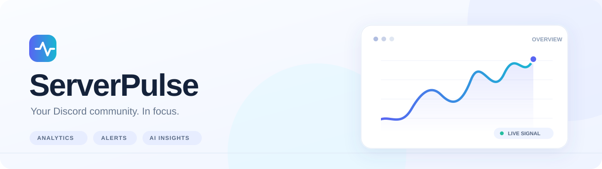
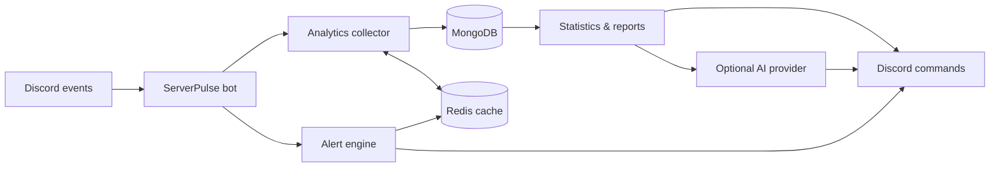

<div align="center">



<br />

**Understand your community. Spot unusual activity. Turn Discord events into actionable insights.**

Self-hosted Discord analytics, live alerts, engagement leaderboards, voice statistics, and AI-powered community reports.

<br />

[](https://www.python.org/)
[](https://discordpy.readthedocs.io/)
[](https://docs.docker.com/compose/)
[](https://github.com/sizwinz/ServerPulse/stargazers)
[](https://github.com/sizwinz/ServerPulse/issues)

[**Get started**](#-quick-start) · [**Explore features**](#-features) · [**Commands**](#-slash-commands) · [**Architecture**](#-how-it-works) · [**Report an issue**](https://github.com/sizwinz/ServerPulse/issues)

</div>

---

## Overview

**ServerPulse** is a self-hosted analytics bot designed to help Discord community administrators understand participation and respond to unusual server activity—without relying on an external analytics dashboard.

It collects event metadata from selected channels, tracks member and voice activity, and presents insights through native Discord slash commands, alerts, and scheduled reports. Optional AI integrations can turn those metrics into readable summaries and suggestions.

> [!NOTE]
> This repository contains a **self-hosted bot**, not a public, hosted bot-invite service. You will need your own Discord application and a running deployment.

## ✨ Features

<table>
<tr>
<td width="50%" valign="top">

### 📊 Community analytics

Explore message volume, active contributors, channel engagement, and server activity across multiple time ranges. Compare participation using built-in leaderboards and statistics.

</td>
<td width="50%" valign="top">

### 🚨 Activity alerts

Watch for sudden join surges, activity spikes or drops, mass message deletions, and unusual voice-channel activity. Send notifications to a configured updates channel.

</td>
</tr>
<tr>
<td width="50%" valign="top">

### 🤖 AI-powered reports

Generate on-demand or scheduled hourly, daily, and weekly summaries. Configure an AI provider per server: **OpenRouter, Gemini, OpenAI, or Grok**.

</td>
<td width="50%" valign="top">

### 🎙️ Voice analytics

See voice-channel activity, participation time, popular channels, and voice leaderboards to understand how members engage beyond text.

</td>
</tr>
<tr>
<td width="50%" valign="top">

### 🔐 Selective message tracking

Administrators explicitly choose which text channels to monitor. Message analytics store metadata rather than raw message bodies or attachment files.

</td>
<td width="50%" valign="top">

### 🛠️ Admin controls and exports

Use a guided setup command, configure alert types and digest frequency, export analytics as **CSV or JSON**, and inspect scheduled-task health.

</td>
</tr>
</table>

## 🚀 Quick start

### Prerequisites

- [Docker Engine / Docker Desktop](https://docs.docker.com/get-docker/) with Docker Compose
- A [Discord application and bot token](https://discord.com/developers/applications)
- A Discord server where you can add and configure the bot
- An optional AI provider key for AI reports

### 1. Clone the project

```bash
git clone https://github.com/sizwinz/ServerPulse.git
cd ServerPulse
```

### 2. Configure your environment

Copy the sample configuration:

```bash
cp .env.example .env
```

**Windows PowerShell:**

```powershell
Copy-Item .env.example .env
```

Set `BOT_TOKEN` to your Discord bot token in `.env`. Keep `.env` private and never commit real API keys.

> [!IMPORTANT]
> In the [Discord Developer Portal](https://discord.com/developers/applications), enable the **Server Members**, **Message Content**, and **Presence** privileged gateway intents used by the current bot code. Invite your bot using the `bot` and `applications.commands` scopes, with the permissions needed to view tracked channels, send messages, and manage its updates channel if desired.

### 3. Check the current Compose configuration

The repository's `docker-compose.yml` references `./scripts/mongo-init.js`, but the checked-in initializer is at `./src/scripts/mongo-init.js`.

**Before launching**, change the MongoDB bind mount in `docker-compose.yml` to:

```yaml
- ./src/scripts/mongo-init.js:/docker-entrypoint-initdb.d/mongo-init.js:ro
```

> [!WARNING]
> The current `Dockerfile` also includes an HTTP health check targeting `localhost:8000/health`, but the bot entry point does not start an HTTP health server. As a result, Docker may report the bot container as **unhealthy even if the Discord process is running**. Remove or correct that health check before treating health status as reliable. These are existing deployment issues, not additional setup requirements by design.

### 4. Start the stack

```bash
docker compose up -d --build
```

This starts the bot along with **MongoDB 6** and **Redis 7.2**. To inspect startup:

```bash
docker compose ps
docker compose logs -f serverpulse
```

### 5. Configure ServerPulse in Discord

Once your bot is connected, run:

1. `/setup` — open the interactive server setup.
2. `/set-update-channel` — choose where reports and alerts appear.
3. `/add-collect-channel` — opt a text channel into analytics.
4. `/ai-provider` — select and configure a provider if you want AI reports.
5. `/set-digest` — select hourly, daily, weekly, or disabled reports.
6. `/test-update` — verify that the configured channel can receive updates.

**Tip:** Use `/server-info` to inspect your server's configuration after setup. AI reports require a provider key configured through the bot's per-server AI settings; simply placing a provider key in `.env` does not configure that guild's saved key.

## ⌨️ Slash commands

<details>
<summary><strong>📈 Analytics and leaderboards</strong></summary>

| Command | Purpose |
| --- | --- |
| `/serverstats` | Server-wide activity statistics for a selected period |
| `/topmessagers` | Rank the most active message senders |
| `/leaderboard` | View activity rankings for a text channel |
| `/user-stats` | See a member's recorded message activity |
| `/voice-stats` | Inspect voice engagement and channel statistics |
| `/voice-leaderboard` | Rank members by recorded voice participation |
| `/server-info` | View the current ServerPulse server configuration |

</details>

<details>
<summary><strong>⚙️ Setup and administration</strong></summary>

| Command | Purpose |
| --- | --- |
| `/setup` | Run the interactive setup wizard |
| `/set-update-channel` | Choose the notifications and reports channel |
| `/add-collect-channel` | Include a text channel in message analytics |
| `/remove-collect-channel` | Stop collecting message analytics from a channel |
| `/toggle-alert` | Enable or disable an alert category |
| `/set-digest` | Set report frequency: none, hourly, daily, or weekly |
| `/ai-provider` | Select, add a key for, test, or view an AI provider |
| `/test-update` | Send a test notification |
| `/pulse-now` | Request an AI-generated report on demand |
| `/export-report` | Export analytics to CSV or JSON |
| `/task-status` | Inspect scheduled background task status |
| `/reset-task-stats` | Reset task-monitoring statistics |

</details>

> [!TIP]
> Most configuration commands require **server administrator permissions**. Discord displays the supported command options and time periods when you select a slash command.

## 🔔 Alert categories

| Signal | Default setting | What it helps detect |
| --- | --- | --- |
| Join raid | 10 recent joins | Unusually rapid influx of members |
| Activity drop | 50% threshold | Lower message activity relative to a baseline |
| Activity spike | Derived from activity threshold | Higher-than-usual message activity |
| Mass deletion | 5 deletions | Rapid or bulk message deletion |
| Voice surge | 3× threshold | Elevated voice-channel occupancy |

The alert engine uses Redis cooldowns to help limit repetitive notifications. Thresholds are configured through environment defaults and guild settings; detection is heuristic, not a security guarantee.

## 🧠 AI reports

ServerPulse supports **OpenRouter · Google Gemini · OpenAI · Grok** through provider-specific integrations.

Reports can include community activity summaries, engagement patterns, and suggested improvements based on collected analytics. Set the active provider using `/ai-provider`, add and test a key, then choose a schedule with `/set-digest`. Run `/pulse-now` to generate a report manually.

AI features are **optional**. Their availability and quality depend on provider credentials, provider APIs, and usable activity data.

## 🔒 Privacy and data handling

ServerPulse is designed to track **activity metadata**, rather than store full Discord conversations.

| Data | Handling in the current code |
| --- | --- |
| Message content | Not saved as raw message text |
| Message analytics | Stores server, channel, and user IDs; timestamp; message length; attachment-presence flag |
| Member activity | Records join and leave events with member IDs and timestamps |
| Voice activity | Records voice events and timed participation sessions |
| AI reports | Generated report text and related metadata are stored in MongoDB |
| AI credentials | Per-server AI keys are stored in guild settings in MongoDB |
| Retention | Background cleanup targets activity events, sessions, and saved reports, using `DATA_RETENTION_DAYS` (default: 90) |

> [!CAUTION]
> **Do not treat per-server AI keys as encrypted at rest.** The current implementation stores keys in MongoDB guild settings without an application-level encryption step, despite an in-bot message suggesting otherwise. Secure the database, restrict access, and use narrowly scoped credentials. Analytics metadata includes identifiable user IDs. Data retention is implemented by scheduled cleanup, not an automatic database TTL guarantee.

AI-generated summaries may send aggregated analytics data to the selected external AI provider. Review that provider's policies before enabling AI functionality.

## 🧩 How it works



| Component | Technology | Role |
| --- | --- | --- |
| Discord integration | Python 3.11 + discord.py 2.4 | Events, slash commands, and embeds |
| Analytics | Python | Activity aggregation and leaderboards |
| Persistent storage | MongoDB 6 | Guild settings, events, sessions, and reports |
| Cache and cooldowns | Redis 7.2 | Cached metrics and alert throttling |
| AI integrations | OpenRouter, Gemini, OpenAI, Grok | Optional natural-language reports |
| Deployment | Docker + Compose | Self-hosted application and services |

<details>
<summary><strong>📂 Project structure</strong></summary>

```text
ServerPulse/
├── src/
│   ├── ai/                 # Provider integrations and report formatting
│   ├── commands/           # Discord slash commands
│   ├── core/               # Bot, analytics, and alert logic
│   ├── database/           # MongoDB and Redis access
│   ├── scripts/            # Database init and maintenance tools
│   ├── utils/              # Formatting, helpers, and logging
│   ├── config.py           # Application settings
│   └── main.py             # Entry point
├── assets/                 # Documentation graphics
├── .env.example            # Example configuration
├── docker-compose.yml      # Container stack
├── Dockerfile              # Bot container image
└── requirements.txt        # Python dependencies
```

</details>

## ⚙️ Configuration

The [`.env.example`](.env.example) file provides a starting point.

| Variable | Description | Default / note |
| --- | --- | --- |
| `BOT_TOKEN` | Discord bot token | **Required** |
| `MONGODB_URI` | MongoDB connection URI | Overridden to the Compose MongoDB service in Docker |
| `REDIS_URL` | Redis connection URI | Overridden to the Compose Redis service in Docker |
| `AI_PROVIDER` | Default provider for new guild settings | `openrouter` |
| `OPENROUTER_API_KEY` | Optional application-level provider key | Per-guild AI report configuration uses guild-stored keys |
| `GEMINI_API_KEY` | Optional application-level provider key | Same caveat |
| `OPENAI_API_KEY` | Optional application-level provider key | Same caveat |
| `GROK_API_KEY` | Optional application-level provider key | Same caveat |
| `DATA_RETENTION_DAYS` | Age threshold for scheduled data cleanup | `90` |
| `LOG_LEVEL` | Logging verbosity | `INFO` |
| `DEBUG` | Debug logging switch | `False` |
| `DEVELOPER_GUILD_ID` | Optional guild for development command sync | Leave unset for global sync |
| `DEFAULT_ALERT_THRESHOLD_*` | Default alert detection thresholds | Defined in `.env.example` |
| `CACHE_TTL_*` | Leaderboard and statistics cache TTLs | Defined in `.env.example` |

> [!NOTE]
> The sample `.env.example` contains example values and inline explanatory comments. Use valid, clean environment-variable values in your actual `.env`, and remove placeholder entries that do not apply to your deployment.

## 🐳 Operations

Run these commands from the cloned repository directory.

| Action | Command |
| --- | --- |
| Start | `docker compose up -d` |
| Start / rebuild | `docker compose up -d --build` |
| View status | `docker compose ps` |
| Follow logs | `docker compose logs -f serverpulse` |
| Restart bot | `docker compose restart serverpulse` |
| Stop | `docker compose down` |
| Debug services | `docker compose --profile debug up -d` |

**Persistent storage:** MongoDB and Redis use named Docker volumes. Avoid `docker compose down -v` unless you deliberately intend to remove stored data.

**Deployment security:** The current Compose file publishes MongoDB and Redis ports to the host. For an internet-facing host, restrict these bindings to trusted interfaces or remove unnecessary published ports; do not expose either database publicly without appropriate authentication and network controls.

**Health checks:** Refer to the Dockerfile caveat in [Quick start](#-quick-start) if Docker reports the bot as unhealthy.

## 🤝 Contributing

Contributions, bug reports, and improvements are welcome. Open an [issue](https://github.com/sizwinz/ServerPulse/issues) to describe a problem or propose an improvement, or submit a pull request with a focused description of your changes.

Useful areas include anomaly detection, configuration and deployment reliability, privacy and security hardening, new AI providers, test coverage, and improved analytics.

## 📄 License

**License clarification:** The earlier README described the project as MIT-licensed, but this repository does not currently contain a `LICENSE` file. Do not assume the project is licensed under MIT until the maintainers add a license or otherwise explicitly grant those rights.

## 💬 Support

Found a bug or have an idea? [Open a GitHub issue](https://github.com/sizwinz/ServerPulse/issues).

---

<div align="center">

**ServerPulse** · Built for communities that want to understand their activity.

<sub>Made by <a href="https://github.com/sizwinz">sizwinz</a> · <a href="https://github.com/sizwinz/ServerPulse">Source code</a> · <a href="https://github.com/sizwinz/ServerPulse/issues">Issues</a></sub>

</div>
